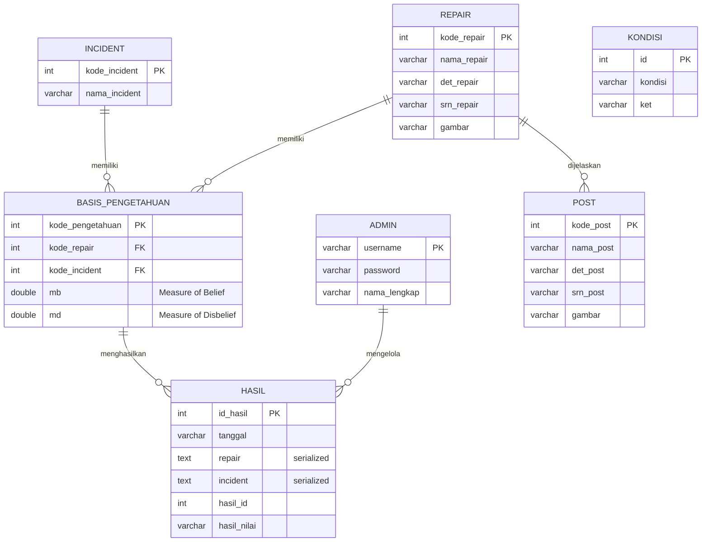

# ERD Database - Sistem Pakar Diagnosis Gangguan IndiHome

## Entity Relationship Diagram

## Penjelasan Entitas

### 1. ADMIN
Menyimpan data administrator/pakar sistem.

**Atribut:**
- `username` (PK): Username login
- `password`: Password MD5
- `nama_lengkap`: Nama lengkap

### 2. REPAIR (Gangguan)
Jenis gangguan IndiHome.

**Contoh:** Create Ulang ONT, Restart ONT, Ganti STB

### 3. INCIDENT (Gejala)  
Gejala yang dialami pengguna.

**Contoh:** Telepon tidak dapat digunakan, Internet tidak terhubung, Lampu PON merah

### 4. BASIS_PENGETAHUAN
Aturan IF-THEN dengan Certainty Factor.

**Format:** IF gejala THEN gangguan {MB: x, MD: y}

### 5. KONDISI
Tingkat kepastian (Pasti ya s/d Pasti tidak)

### 6. HASIL
Riwayat diagnosis pengguna

### 7. POST
Artikel penjelasan gangguan
