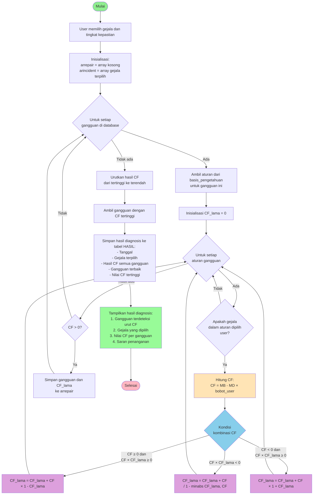

# Flowchart Forward Chaining - Sistem Pakar Diagnosis Gangguan IndiHome

## Algoritma Forward Chaining dengan Certainty Factor



## Penjelasan Algoritma

### 1. Input Gejala
User memilih gejala yang dialami dan tingkat kepastian (1-9):
- 1: Pasti ya (bobot 1.0)
- 2: Hampir pasti ya (bobot 0.8)
- 3: Kemungkinan besar ya (bobot 0.6)
- 4: Mungkin ya (bobot 0.4)
- 5: Tidak tahu (bobot 0.0)
- 6: Mungkin tidak (bobot -0.2)
- 7: Kemungkinan besar tidak (bobot -0.4)
- 8: Hampir pasti tidak (bobot -0.6)
- 9: Pasti tidak (bobot -0.8)

### 2. Proses Inferensi (Forward Chaining)
Sistem menelusuri dari fakta (gejala) menuju kesimpulan (gangguan):

**a. Iterasi Gangguan:**
- Untuk setiap gangguan dalam database

**b. Ambil Aturan:**
- Query basis_pengetahuan untuk gangguan tersebut
- Dapatkan semua aturan IF gejala THEN gangguan

**c. Hitung CF per Aturan:**
```
CF = (MB - MD) × bobot_user
```
Dimana:
- MB = Measure of Belief (dari pakar)
- MD = Measure of Disbelief (dari pakar)
- bobot_user = tingkat kepastian user

**d. Kombinasi CF:**
Jika ada >1 gejala untuk gangguan yang sama:

**Kasus 1: Keduanya positif**
```
CF_kombinasi = CF1 + CF2 × (1 - CF1)
```

**Kasus 2: Keduanya negatif**
```
CF_kombinasi = CF1 + CF2 × (1 + CF1)
```

**Kasus 3: Salah satu negatif**
```
CF_kombinasi = (CF1 + CF2) / (1 - min(|CF1|, |CF2|))
```

### 3. Hasil Diagnosis
- Urutkan gangguan berdasarkan CF (descending)
- Gangguan dengan CF tertinggi = diagnosis utama
- Simpan ke database untuk riwayat
- Tampilkan ke user dengan saran penanganan

## Contoh Perhitungan

**Input User:**
- Gejala 1: "Telepon tidak dapat digunakan" - Pasti ya (bobot 1.0)
- Gejala 2: "Internet tidak terhubung" - Pasti ya (bobot 1.0)

**Aturan dari Basis Pengetahuan:**
```
R1: IF "Telepon tidak dapat digunakan" THEN "Create Ulang ONT" {MB:0.7, MD:0.1}
R2: IF "Internet tidak terhubung" THEN "Create Ulang ONT" {MB:0.8, MD:0.2}
```

**Perhitungan:**

**R1:**
```
CF1 = (0.7 - 0.1) × 1.0 = 0.6
```

**R2:**
```
CF2 = (0.8 - 0.2) × 1.0 = 0.6
```

**Kombinasi (keduanya positif):**
```
CF_kombinasi = 0.6 + 0.6 × (1 - 0.6)
             = 0.6 + 0.6 × 0.4
             = 0.6 + 0.24
             = 0.84 (84%)
```

**Hasil:**
"Create Ulang ONT" dengan tingkat keyakinan 84%

## Keuntungan Forward Chaining

1. **Data-Driven**: Mulai dari fakta yang ada (gejala)
2. **Natural**: Sesuai dengan proses diagnosis alami teknisi
3. **Efisien**: Hanya mengevaluasi aturan yang relevan
4. **Transparan**: User dapat melihat alur penalaran
5. **Flexible**: Mudah menambah aturan baru

## Implementasi dalam Kode

File: `modul/diagnosa/diagnosa.php`

```php
// Loop setiap gangguan
$sqlrepair = mysqli_query($conn, "SELECT * FROM repair order by kode_repair");
while ($rrepair = mysqli_fetch_array($sqlrepair)) {
    $cflama = 0;
    
    // Ambil aturan untuk gangguan ini
    $sqlincident = mysqli_query($conn, 
        "SELECT * FROM basis_pengetahuan where kode_repair=$rrepair[kode_repair]");
    
    while ($rincident = mysqli_fetch_array($sqlincident)) {
        // Cek apakah gejala dipilih user
        for ($i = 0; $i < count($_POST['kondisi']); $i++) {
            $arkondisi = explode("_", $_POST['kondisi'][$i]);
            $incident = $arkondisi[0];
            
            if ($rincident['kode_incident'] == $incident) {
                // Hitung CF
                $cf = ($rincident['mb'] - $rincident['md']) * $arbobot[$arkondisi[1]];
                
                // Kombinasi CF
                if (($cf >= 0) && ($cf * $cflama >= 0)) {
                    $cflama = $cflama + ($cf * (1 - $cflama));
                }
                if ($cf * $cflama < 0) {
                    $cflama = ($cflama + $cf) / (1 - min(abs($cflama), abs($cf)));
                }
                if (($cf < 0) && ($cf * $cflama >= 0)) {
                    $cflama = $cflama + ($cf * (1 + $cflama));
                }
            }
        }
    }
    
    // Simpan hasil jika CF > 0
    if ($cflama > 0) {
        $arrepair += array($rrepair['kode_repair'] => number_format($cflama, 4));
    }
}

// Urutkan hasil
arsort($arrepair);
```
