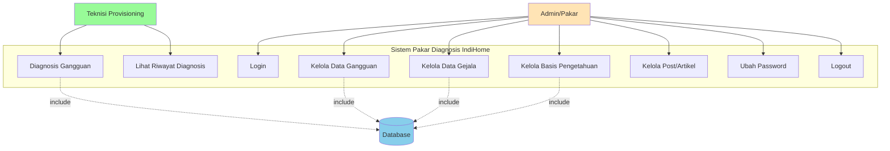
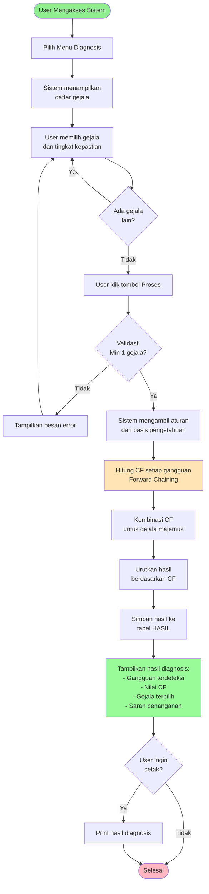
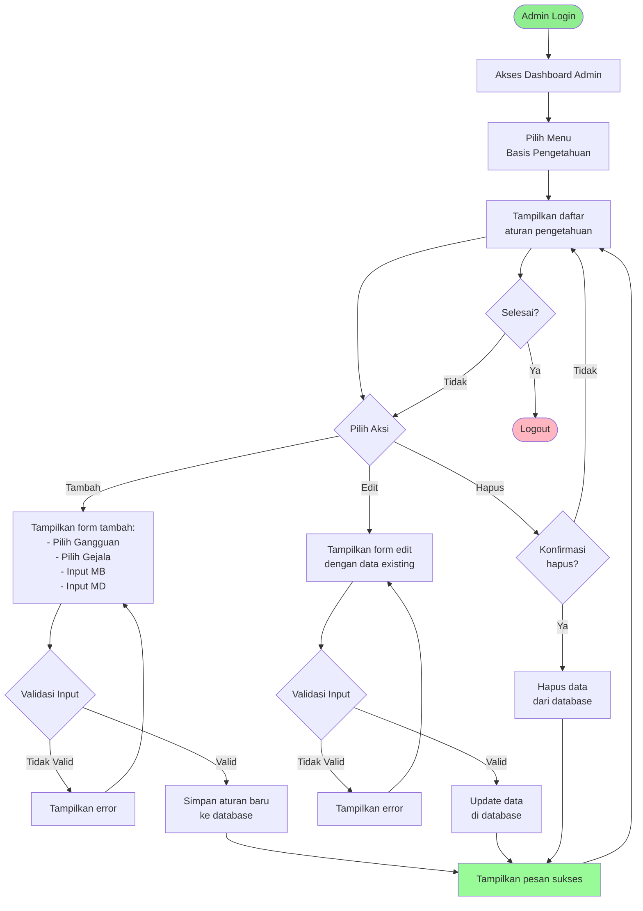
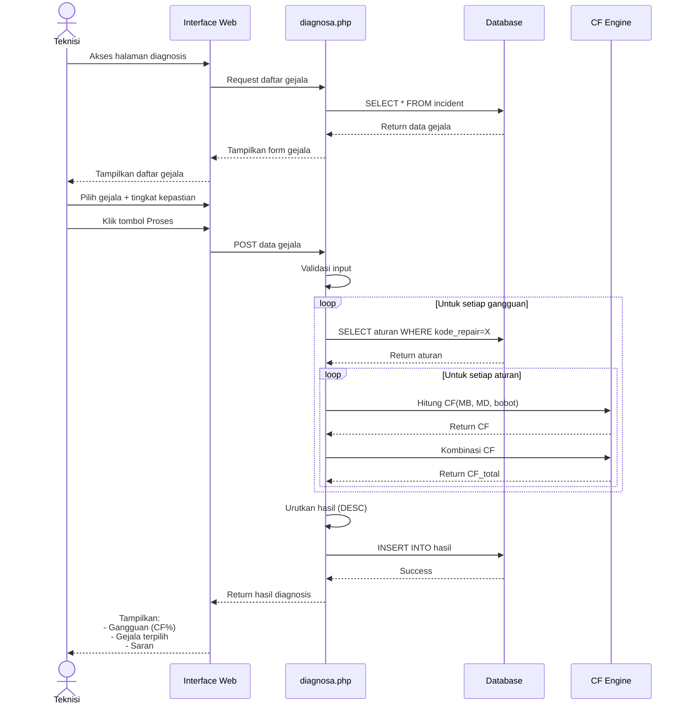
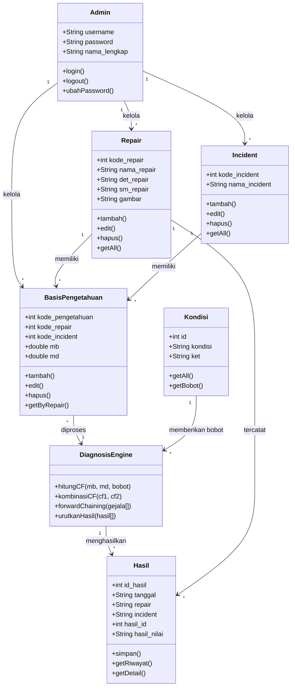
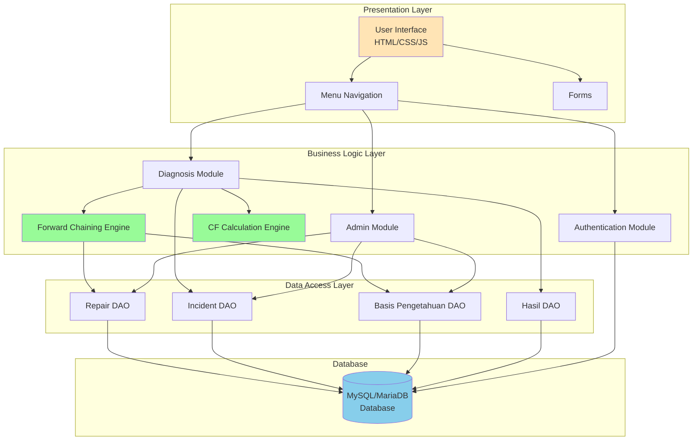

# UML Diagram - Sistem Pakar Diagnosis Gangguan IndiHome

## 1. Use Case Diagram

## 2. Activity Diagram - Proses Diagnosis

## 3. Activity Diagram - Kelola Basis Pengetahuan

## 4. Sequence Diagram - Proses Diagnosis

## 5. Class Diagram

## 6. Component Diagram

## Penjelasan Diagram

### Use Case Diagram
Menggambarkan interaksi antara aktor (Admin dan Teknisi) dengan sistem.

**Admin:**
- Mengelola master data (gangguan, gejala, basis pengetahuan)
- Membuat dan mengubah aturan diagnosis
- Manajemen akun

**Teknisi Provisioning:**
- Melakukan diagnosis gangguan
- Melihat riwayat diagnosis
- Mendapatkan saran penanganan

### Activity Diagram
Menggambarkan alur aktivitas dalam sistem:
1. **Proses Diagnosis**: Alur dari pemilihan gejala hingga hasil diagnosis
2. **Kelola Basis Pengetahuan**: Alur CRUD aturan oleh admin

### Sequence Diagram
Menggambarkan interaksi antar objek dalam urutan waktu untuk proses diagnosis.

### Class Diagram
Menggambarkan struktur kelas dan relasi antar kelas dalam sistem.

### Component Diagram
Menggambarkan arsitektur sistem dengan pembagian layer:
- **Presentation**: Antarmuka pengguna
- **Business Logic**: Logika bisnis dan inferensi
- **Data Access**: Akses database
- **Database**: Penyimpanan data
