# Panduan Pengguna - Sistem Pakar Diagnosis Gangguan IndiHome

## Dokumentasi Cara Kerja Sistem DigNet 2.0

> **Catatan:** Dokumen ini menjelaskan alur kerja sistem dari perspektif pengguna (read-only). Tidak ada perubahan kode yang diperlukan untuk membaca dokumentasi ini.

---

## Daftar Isi

1. [Gambaran Umum Sistem](#1-gambaran-umum-sistem)
2. [Alur Kerja Diagnosis (Flowchart)](#2-alur-kerja-diagnosis-flowchart)
3. [Langkah 1: Mulai - Akses Halaman Diagnosis](#3-langkah-1-mulai---akses-halaman-diagnosis)
4. [Langkah 2: Pilih Gejala Kerusakan](#4-langkah-2-pilih-gejala-kerusakan)
5. [Langkah 3: Input Nilai Certainty Factor](#5-langkah-3-input-nilai-certainty-factor)
6. [Langkah 4: Proses Diagnosis](#6-langkah-4-proses-diagnosis)
7. [Langkah 5: Output - Hasil Diagnosis](#7-langkah-5-output---hasil-diagnosis)
8. [Flowchart Lengkap Proses Pengguna](#8-flowchart-lengkap-proses-pengguna)
9. [Penjelasan Metode Certainty Factor](#9-penjelasan-metode-certainty-factor)
10. [FAQ (Pertanyaan yang Sering Diajukan)](#10-faq-pertanyaan-yang-sering-diajukan)

---

## 1. Gambaran Umum Sistem

**DigNet 2.0** adalah Sistem Pakar Diagnosis Gangguan IndiHome yang menggunakan metode:
- **Forward Chaining**: Inferensi dari fakta (gejala) menuju kesimpulan (gangguan)
- **Certainty Factor (CF)**: Menangani ketidakpastian dengan nilai kepercayaan

### Diagram Konsep Sistem

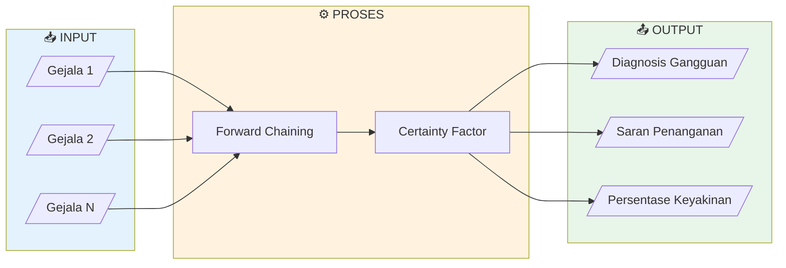

### Legenda Simbol Flowchart

| Simbol | Bentuk | Nama | Kegunaan |
|--------|--------|------|----------|
| `([text])` | Stadium (Rounded) | Terminator | Mulai / Selesai |
| `[text]` | Persegi Panjang | Process | Proses / Aktivitas |
| `{text}` | Belah Ketupat | Decision | Keputusan Ya/Tidak |
| `[/text/]` | Jajaran Genjang | Input/Output | Data masuk/keluar |
| `[(text)]` | Silinder | Database | Penyimpanan data |

### Komponen yang Didiagnosis

Sistem ini mendiagnosis gangguan pada komponen IndiHome berikut:

| Komponen | Deskripsi |
|----------|-----------|
| **ODP** | Optical Distribution Point |
| **ONT** | Optical Network Terminal |
| **STB** | Set-Top Box |
| **Telepon** | Layanan telepon rumah |

---

## 2. Alur Kerja Diagnosis (Flowchart)

### Flowchart Utama - Cara Kerja Sistem

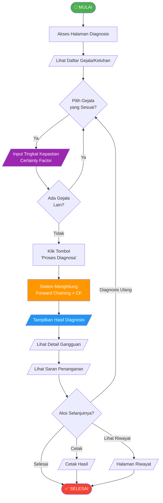

---

## 3. Langkah 1: Mulai - Akses Halaman Diagnosis

### Cara Mengakses

1. Buka browser (Chrome, Firefox, Edge, Safari)
2. Akses URL sistem: `http://localhost/dignet/` atau URL yang diberikan
3. Pada halaman utama, pilih menu **"Diagnosa"** di sidebar kiri

### Flowchart Akses Sistem

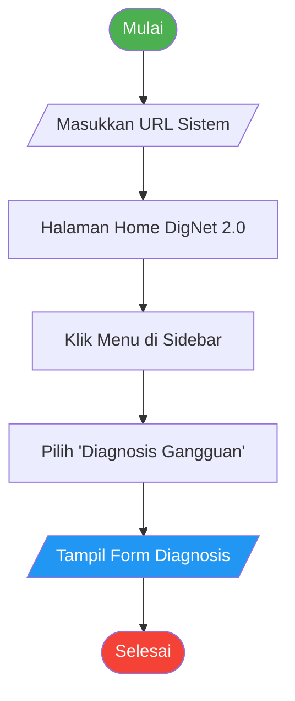

### Tampilan Menu

Di sidebar kiri, Anda akan melihat menu:
- 🏠 Home
- 🔍 **Diagnosis Gangguan** ← Klik ini
- 📋 Riwayat Diagnosis
- 📖 Keterangan
- 💰 Info Harga
- ❓ Bantuan
- ℹ️ Tentang

---

## 4. Langkah 2: Pilih Gejala Kerusakan

### Daftar Gejala yang Tersedia

Sistem menampilkan daftar gejala/keluhan yang mungkin dialami, meliputi:

| Kode | Contoh Gejala |
|------|---------------|
| G001 | Telepon tidak dapat digunakan |
| G002 | Internet tidak terhubung |
| G003 | Lampu indikator PON pada ONU berwarna merah |
| G004 | STB tidak menyala |
| G005 | Layar TV tidak menampilkan gambar |
| ... | Dan gejala lainnya |

### Flowchart Pemilihan Gejala

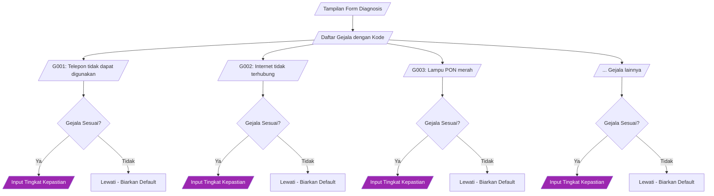

### Cara Memilih Gejala

1. Baca deskripsi setiap gejala dengan seksama
2. Perhatikan kode gejala (G001, G002, dst.)
3. Cocokkan dengan kondisi perangkat IndiHome yang sedang diperiksa
4. Untuk setiap gejala yang sesuai, pilih tingkat kepastian

---

## 5. Langkah 3: Input Nilai Certainty Factor

### Tingkat Kepastian yang Tersedia

Setiap gejala memiliki dropdown untuk memilih tingkat kepastian (Certainty Factor):

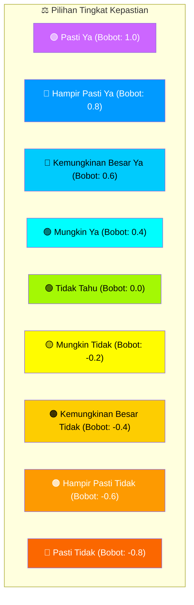

### Tabel Bobot Certainty Factor

| No | Kondisi | Interpretasi | Bobot | Warna |
|----|---------|--------------|-------|-------|
| 1 | **Pasti Ya** | Sangat yakin gejala ada | 1.0 | 🟣 Ungu |
| 2 | **Hampir Pasti Ya** | Hampir yakin | 0.8 | 🔵 Biru |
| 3 | **Kemungkinan Besar Ya** | Cukup yakin | 0.6 | 🔵 Cyan |
| 4 | **Mungkin Ya** | Ragu tapi condong yakin | 0.4 | 🟢 Teal |
| 5 | **Tidak Tahu** | Tidak yakin | 0.0 | 🟢 Lime |
| 6 | **Mungkin Tidak** | Ragu condong tidak | -0.2 | 🟡 Kuning |
| 7 | **Kemungkinan Besar Tidak** | Cukup yakin tidak ada | -0.4 | 🟠 Amber |
| 8 | **Hampir Pasti Tidak** | Hampir yakin tidak ada | -0.6 | 🟠 Orange |
| 9 | **Pasti Tidak** | Sangat yakin tidak ada | -0.8 | 🔴 Merah |

### Flowchart Input Certainty Factor

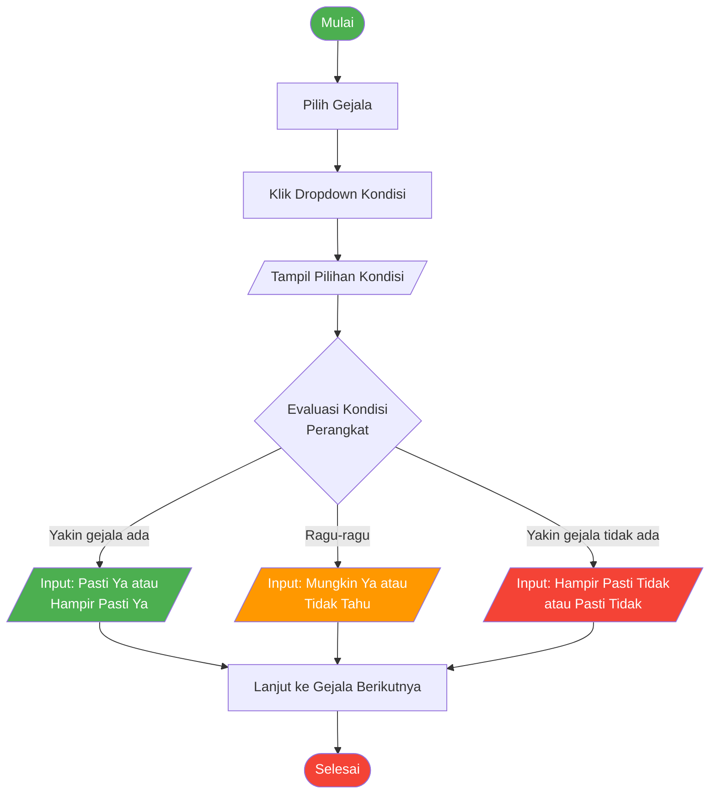

### Tips Memilih Tingkat Kepastian

1. **Amati perangkat** dengan teliti sebelum memilih
2. **Pilih "Pasti Ya"** hanya jika Anda 100% yakin gejala tersebut ada
3. **Pilih "Tidak Tahu"** jika tidak bisa memverifikasi gejala
4. **Pilih nilai negatif** jika yakin gejala tersebut TIDAK ada
5. Semakin akurat pilihan Anda, semakin akurat diagnosis

---

## 6. Langkah 4: Proses Diagnosis

### Setelah Memilih Semua Gejala

1. Pastikan minimal 1 gejala telah dipilih tingkat kepastiannya
2. Review pilihan Anda sebelum submit
3. Klik tombol **"Proses Diagnosa"** di bagian bawah form

### Flowchart Proses Internal Sistem

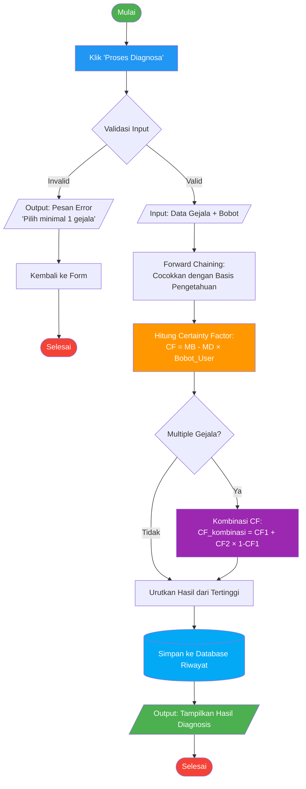

### Apa yang Terjadi di Balik Layar?

1. **Validasi**: Sistem memeriksa apakah ada gejala yang dipilih
2. **Forward Chaining**: Sistem mencocokkan gejala dengan aturan di basis pengetahuan
3. **Perhitungan CF**: Setiap aturan dihitung nilai CF-nya
4. **Kombinasi CF**: Jika ada >1 gejala untuk gangguan yang sama, CF dikombinasikan
5. **Pengurutan**: Hasil diurutkan berdasarkan nilai CF tertinggi
6. **Penyimpanan**: Hasil disimpan ke riwayat diagnosis

---

## 7. Langkah 5: Output - Hasil Diagnosis

### Komponen Hasil Diagnosis

Setelah proses selesai, sistem menampilkan:

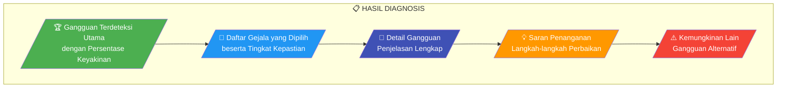

### Contoh Tampilan Hasil

```
┌─────────────────────────────────────────────────────────┐
│ 📊 HASIL DIAGNOSIS                                       │
│ Tanggal: [Contoh] 15 Nov 2024, 10:30                    │
├─────────────────────────────────────────────────────────┤
│ 🏆 DIAGNOSIS UTAMA                                       │
│ ┌─────────────────────────────────────────────────────┐ │
│ │ Create Ulang ONT                                    │ │
│ │ 📈 95.84% Kepercayaan                               │ │
│ └─────────────────────────────────────────────────────┘ │
├─────────────────────────────────────────────────────────┤
│ 📝 GEJALA YANG DIPILIH:                                  │
│ 1. G001 - Telepon tidak dapat digunakan    [Pasti Ya]   │
│ 2. G002 - Internet tidak terhubung         [Pasti Ya]   │
│ 3. G003 - Lampu PON merah                  [Pasti Ya]   │
├─────────────────────────────────────────────────────────┤
│ 📖 DETAIL GANGGUAN:                                      │
│ Gangguan ini terjadi ketika ONT perlu di-create ulang   │
│ pada sistem provisioning...                              │
├─────────────────────────────────────────────────────────┤
│ 💡 SARAN PENANGANAN:                                     │
│ 1. Lakukan create ulang ONT melalui sistem              │
│ 2. Restart ONT setelah create ulang                     │
│ 3. Verifikasi koneksi setelah restart                   │
├─────────────────────────────────────────────────────────┤
│ ⚠️ KEMUNGKINAN LAIN:                                     │
│ • Revisi IKR (66%)                                       │
│ • Ex Gamas FO Putus (60%)                               │
└─────────────────────────────────────────────────────────┘
```

### Interpretasi Nilai Persentase

| Range | Interpretasi | Aksi Disarankan |
|-------|--------------|-----------------|
| **80% - 100%** | Keyakinan sangat tinggi | Diagnosis hampir pasti benar, lakukan penanganan |
| **60% - 79%** | Keyakinan tinggi | Kemungkinan besar benar, verifikasi jika perlu |
| **40% - 59%** | Keyakinan sedang | Perlu verifikasi lebih lanjut sebelum bertindak |
| **20% - 39%** | Keyakinan rendah | Pertimbangkan diagnosis alternatif |
| **0% - 19%** | Keyakinan sangat rendah | Diagnosis kurang dapat dipercaya |

### Aksi Setelah Melihat Hasil

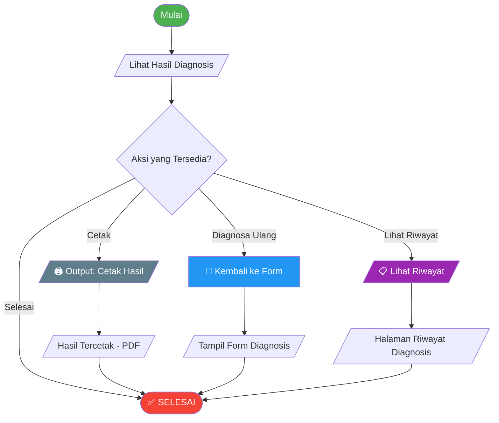

---

## 8. Flowchart Lengkap Proses Pengguna

### Diagram Alur Lengkap End-to-End

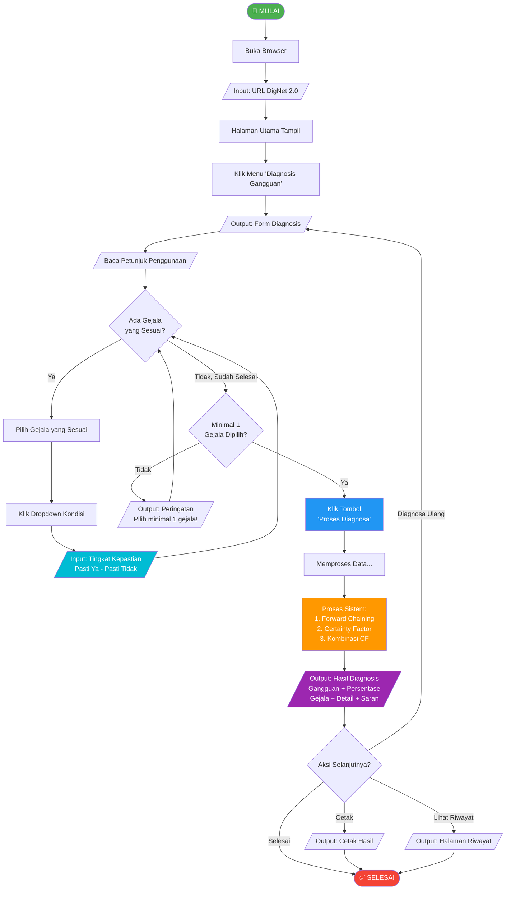

---

## 9. Penjelasan Metode Certainty Factor

### Formula Dasar

```
CF = (MB - MD) × Bobot_User
```

Dimana:
- **MB** = Measure of Belief (dari pakar, nilai 0-1)
- **MD** = Measure of Disbelief (dari pakar, nilai 0-1)
- **Bobot_User** = Tingkat kepastian yang dipilih user (-0.8 s/d 1.0)

### Formula Kombinasi CF

Ketika ada >1 gejala untuk gangguan yang sama:

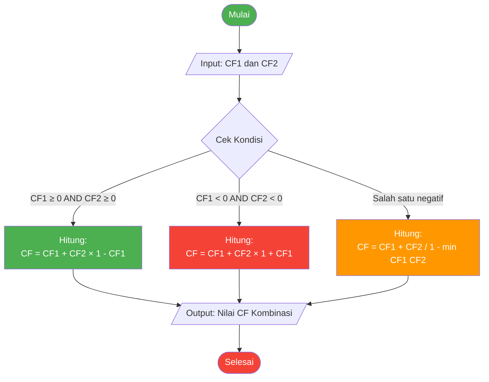

### Contoh Perhitungan

**Skenario:** User memilih 2 gejala untuk gangguan "Create Ulang ONT"

**Gejala 1:** Telepon tidak dapat digunakan (Pasti Ya = 1.0)
- MB = 0.7, MD = 0.1
- CF1 = (0.7 - 0.1) × 1.0 = **0.6**

**Gejala 2:** Internet tidak terhubung (Pasti Ya = 1.0)
- MB = 0.8, MD = 0.2
- CF2 = (0.8 - 0.2) × 1.0 = **0.6**

**Kombinasi (keduanya positif):**
```
CF_kombinasi = CF1 + CF2 × (1 - CF1)
             = 0.6 + 0.6 × (1 - 0.6)
             = 0.6 + 0.6 × 0.4
             = 0.6 + 0.24
             = 0.84 (84%)
```

**Hasil:** Gangguan "Create Ulang ONT" dengan keyakinan **84%**

---

## 10. FAQ (Pertanyaan yang Sering Diajukan)

### Q: Berapa minimal gejala yang harus dipilih?
**A:** Minimal 1 gejala dengan tingkat kepastian selain "Pilih jika sesuai".

### Q: Bagaimana jika hasil diagnosis tidak sesuai?
**A:** Coba lakukan diagnosis ulang dengan tingkat kepastian yang lebih akurat. Pastikan memilih gejala yang benar-benar sesuai kondisi perangkat.

### Q: Apakah saya harus login untuk menggunakan fitur diagnosis?
**A:** Tidak, fitur diagnosis dapat diakses tanpa login. Login hanya diperlukan untuk admin/pakar.

### Q: Bagaimana cara melihat riwayat diagnosis sebelumnya?
**A:** Klik menu "Riwayat Diagnosis" di sidebar. Semua hasil diagnosis akan tersimpan dengan tanggal dan waktu.

### Q: Apa yang harus dilakukan setelah mendapat hasil diagnosis?
**A:** 
1. Baca saran penanganan yang diberikan
2. Jika perlu, cetak hasil untuk dokumentasi
3. Lakukan penanganan sesuai saran
4. Jika masalah berlanjut, konsultasikan dengan teknisi senior

### Q: Apakah diagnosis ini 100% akurat?
**A:** Sistem pakar memberikan rekomendasi berdasarkan basis pengetahuan dan input yang diberikan. Akurasi tergantung pada:
- Kelengkapan data gejala yang dipilih
- Ketepatan tingkat kepastian yang dipilih
- Kelengkapan basis pengetahuan dalam sistem

---

## Referensi

- [BAB3_FLOWCHART_FORWARD_CHAINING.md](./BAB3_FLOWCHART_FORWARD_CHAINING.md) - Flowchart algoritma
- [BAB3_TABEL_PERHITUNGAN_CF.md](./BAB3_TABEL_PERHITUNGAN_CF.md) - Tabel perhitungan CF
- [BAB3_UML_DIAGRAM.md](./BAB3_UML_DIAGRAM.md) - UML Diagram sistem
- [BAB3_ERD_DATABASE.md](./BAB3_ERD_DATABASE.md) - ERD Database

---

*Dokumentasi ini dibuat untuk DigNet 2.0 - Sistem Pakar Diagnosis Gangguan IndiHome*  
*Versi Dokumen: 1.0*  
*Repository: GalangPutraMaulana19/DigNet-BUG*
