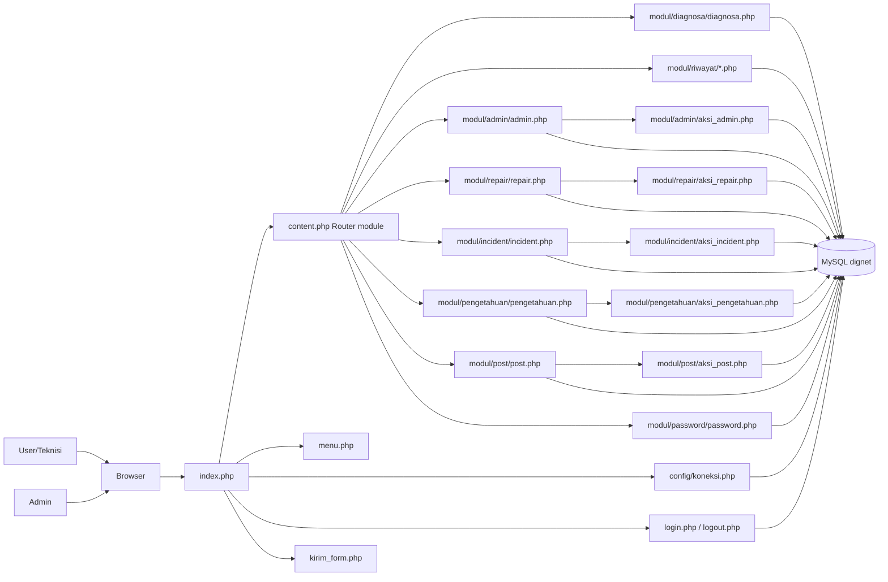

# 01 - Arsitektur Sistem

## Ringkasan Arsitektur Sistem Pakar Diagnosis Gangguan Layanan IndiHome

Aplikasi menggunakan arsitektur **modular berbasis PHP procedural** dengan **front controller sederhana** (`index.php`) yang melakukan routing berdasarkan query string `module` lalu memuat file modul terkait melalui `content.php`.

Tidak ditemukan implementasi framework MVC formal (misalnya Laravel/CodeIgniter), route file khusus, atau middleware class terpisah.

## Komponen Sistem

1. **Client/UI (Browser)**
   - Halaman publik dan admin dirender server-side oleh file PHP modul.
2. **Front Controller**
   - `index.php` memulai session, koneksi DB, memuat menu+konten.
3. **Module Router**
   - `content.php` memilih modul berdasarkan `?module=...`.
4. **Business Modules**
   - Diagnosa, riwayat, admin, gangguan, gejala, basis pengetahuan, post, password.
5. **Action Handlers (CRUD)**
   - File `aksi_*.php` memproses input tambah/ubah/hapus.
6. **Authentication**
   - `login.php`, `logout.php`, pengecekan `$_SESSION['username']` di modul admin.
7. **Database Layer**
   - MySQL via `mysqli` (`config/koneksi.php`).
8. **Contact Service**
   - Form modal di `index.php` mengirim ke `kirim_form.php` (email via `mail()`).

## Alur Komunikasi Antar Komponen

1. Browser request ke `index.php`.
2. `index.php` inisialisasi session + koneksi DB.
3. `content.php` memilih modul dari parameter `module`.
4. Modul menampilkan form/hasil (query `SELECT` ke DB).
5. Untuk aksi data, form submit ke `modul/*/aksi_*.php`.
6. `aksi_*.php` validasi session + CSRF (POST), eksekusi query, lalu redirect ke `index.php?module=...`.
7. Untuk login, form ke `login.php`; jika sukses set session dan redirect.
8. Untuk logout, `logout.php` menghancurkan session.

## Diagram Arsitektur (Mermaid)

## Referensi Source Code

- `index.php`
- `content.php`
- `menu.php`
- `config/koneksi.php`
- `login.php`
- `logout.php`
- `kirim_form.php`
- `modul/diagnosa/diagnosa.php`
- `modul/riwayat/riwayat.php`
- `modul/riwayat/detail.php`
- `modul/admin/admin.php`
- `modul/admin/aksi_admin.php`
- `modul/repair/repair.php`
- `modul/repair/aksi_repair.php`
- `modul/incident/incident.php`
- `modul/incident/aksi_incident.php`
- `modul/pengetahuan/pengetahuan.php`
- `modul/pengetahuan/aksi_pengetahuan.php`
- `modul/post/post.php`
- `modul/post/aksi_post.php`
- `modul/password/password.php`
