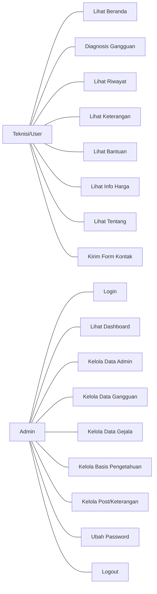

# 04 - Use Case Diagram

## Aktor

1. **Teknisi/User Publik**
   - Mengakses fitur diagnosis, riwayat, keterangan, bantuan, harga, tentang.
2. **Admin**
   - Login dan mengelola data master + basis pengetahuan + post + password.

## Use Case Teknisi

### Daftar Use Case

| Use Case | Deskripsi Singkat |
|---|---|
| Lihat Beranda | Melihat halaman utama sistem |
| Diagnosis Gangguan | Memilih gejala dan mendapatkan hasil diagnosis |
| Lihat Riwayat | Melihat histori hasil diagnosis |
| Lihat Keterangan | Melihat artikel/detail gangguan dan saran |
| Lihat Bantuan | Membaca panduan penggunaan sistem |
| Lihat Info Harga | Melihat halaman referensi harga (konten scraping eksternal) |
| Lihat Tentang | Melihat informasi aplikasi |
| Kirim Kontak | Mengirim pesan melalui modal kontak |

## Use Case Admin

### Daftar Use Case

| Use Case | Deskripsi Singkat |
|---|---|
| Login | Otentikasi admin |
| Lihat Dashboard | Melihat statistik data sistem |
| Kelola Data Admin | CRUD akun admin |
| Kelola Data Gangguan | CRUD data repair/gangguan |
| Kelola Data Gejala | CRUD data incident/gejala |
| Kelola Basis Pengetahuan | CRUD rule MB/MD |
| Kelola Post/Keterangan | CRUD artikel gangguan |
| Ubah Password | Mengubah password akun sendiri |
| Logout | Mengakhiri sesi |

## Diagram Use Case (Mermaid)

## Catatan Ketersediaan Informasi

- Tidak ditemukan dokumen Use Case formal di source code; diagram di atas disusun dari implementasi menu, routing modul, dan aksi yang benar-benar ada.
- Tidak ditemukan role selain user publik dan admin pada mekanisme autentikasi.

## Referensi Source Code

- `menu.php`
- `content.php`
- `modul/diagnosa/diagnosa.php`
- `modul/riwayat/riwayat.php`
- `modul/keterangan.php`
- `modul/bantuan.php`
- `modul/harga.php`
- `modul/tentang.php`
- `index.php` (fungsi `kirimContactForm`)
- `kirim_form.php`
- `login.php`
- `logout.php`
- `modul/dashboard.php`
- `modul/admin/admin.php`
- `modul/repair/repair.php`
- `modul/incident/incident.php`
- `modul/pengetahuan/pengetahuan.php`
- `modul/post/post.php`
- `modul/password/password.php`
