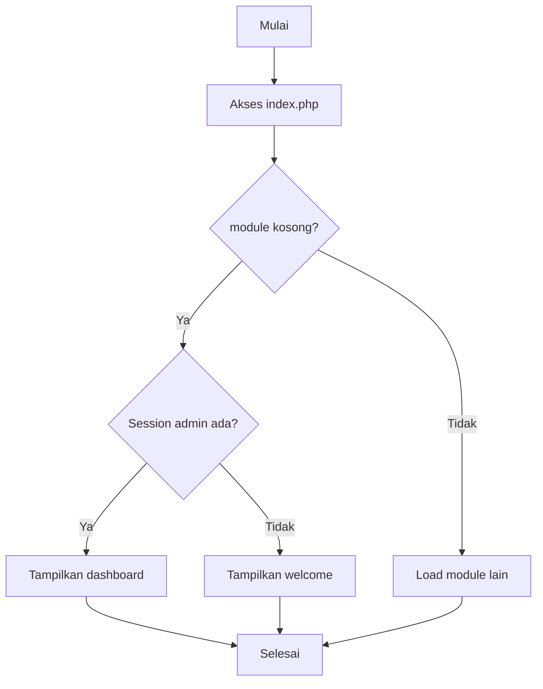
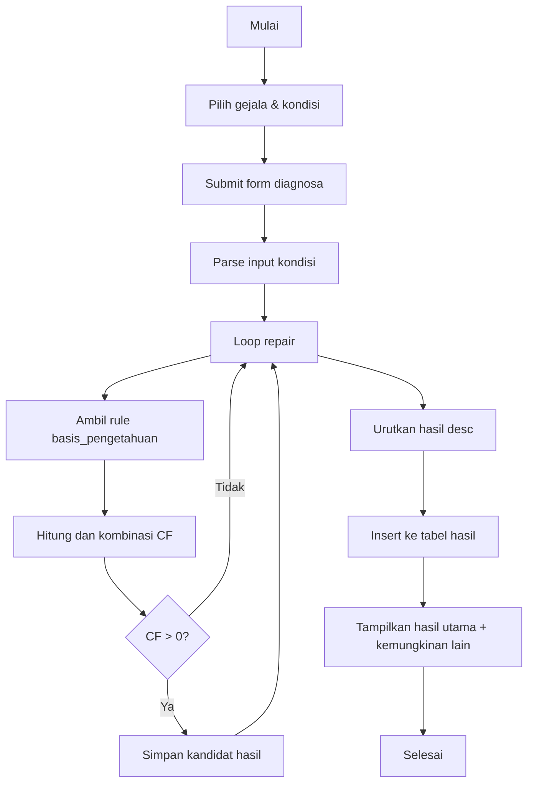
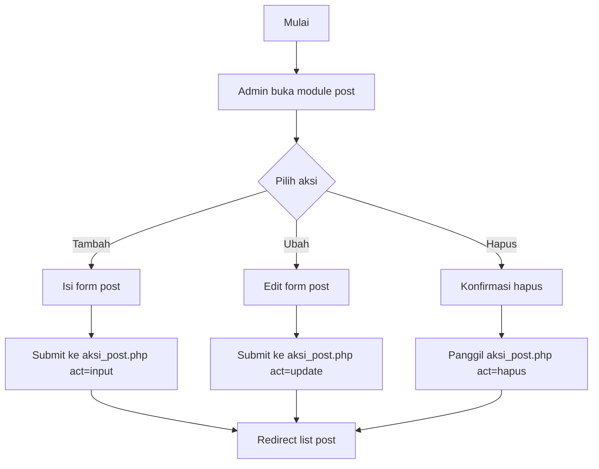
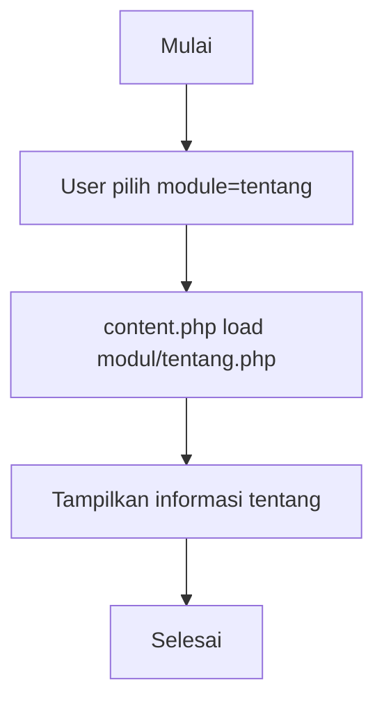
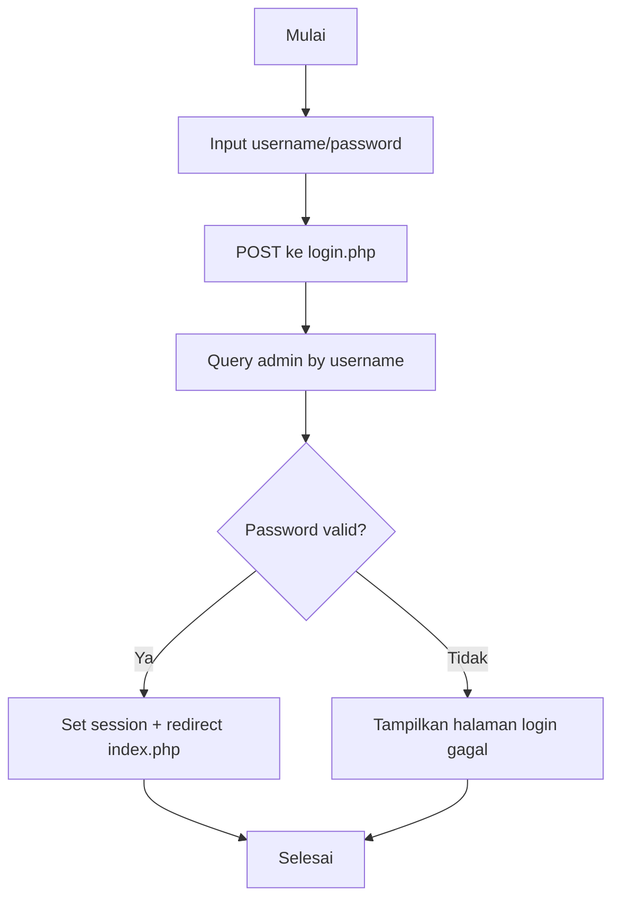
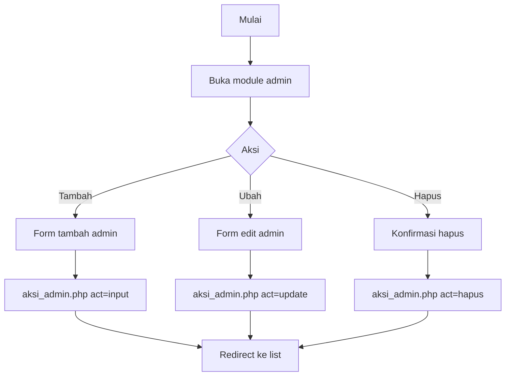
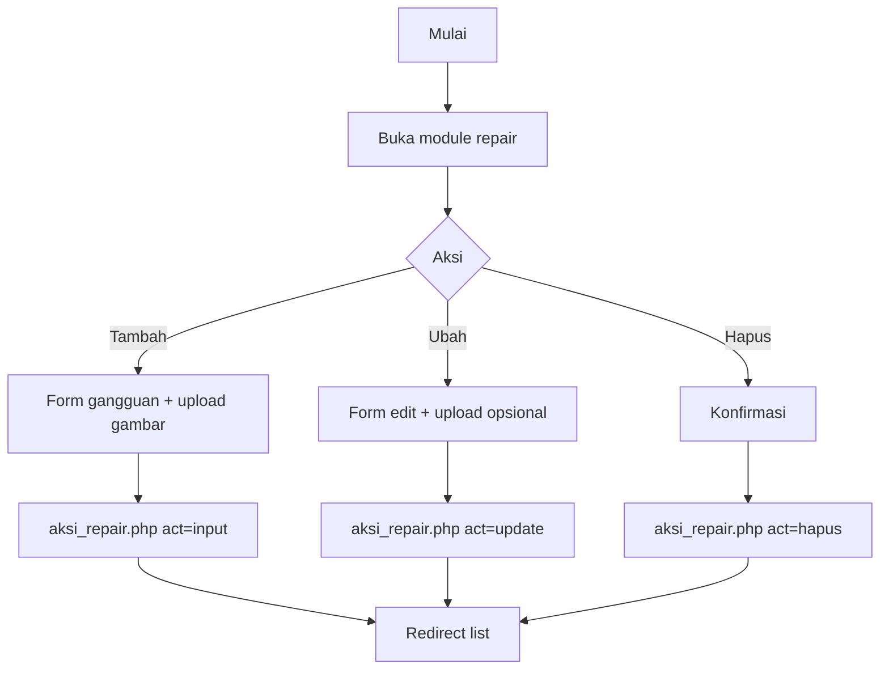
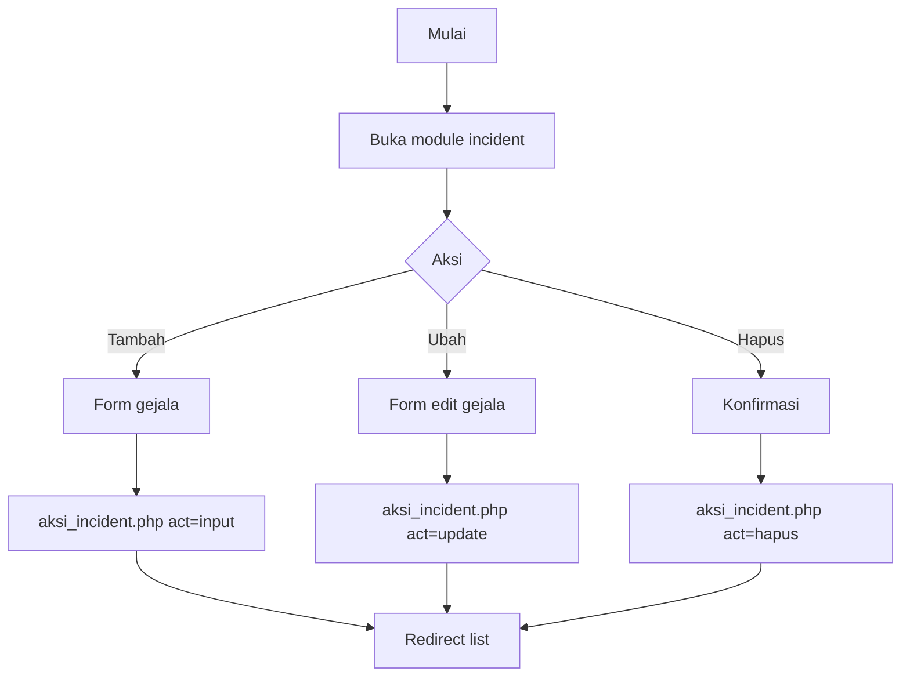
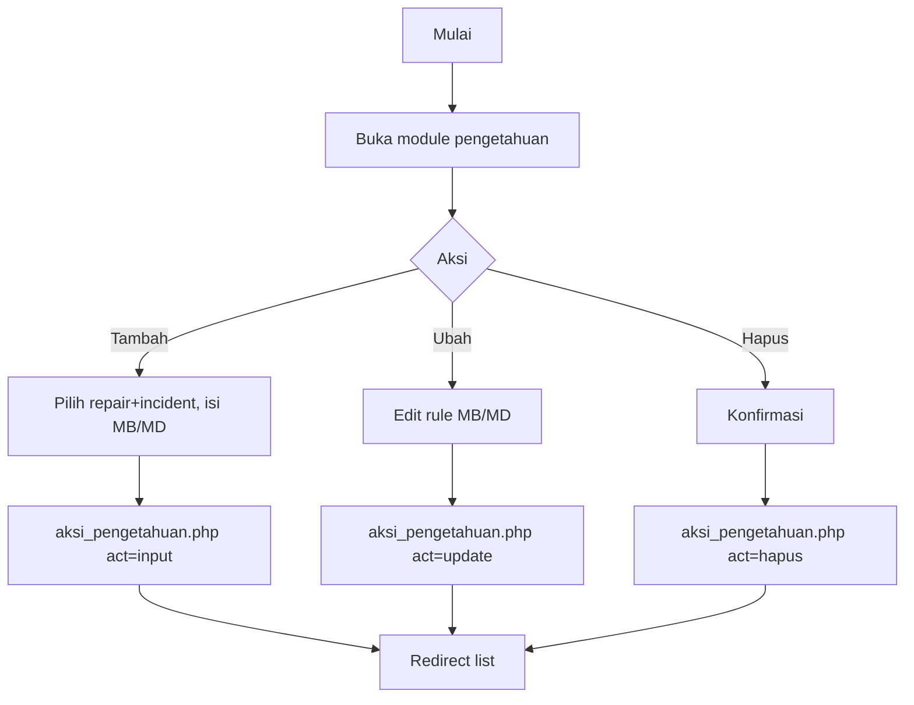
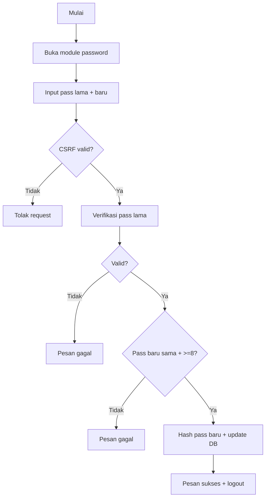

# 05 - Activity Diagram

## 1) Beranda

**Narasi:** User/admin membuka aplikasi, sistem memilih konten beranda sesuai status login.

**Langkah proses & keputusan:**
1. Akses `index.php`.
2. `content.php` cek `module`.
3. Jika `module` kosong: cek session admin.
4. Session ada -> `modul/dashboard.php`; tidak ada -> `modul/welcome.php`.



## 2) Diagnosis Gangguan

**Narasi:** User memilih gejala+tingkat keyakinan, sistem hitung FC+CF, simpan hasil.



## 3) Kelola Artikel/Keterangan (Post)

**Narasi:** Admin mengelola konten artikel post untuk halaman keterangan.



## 4) Tentang

**Narasi:** Sistem menampilkan profil aplikasi dan informasi tim.



## 5) Login Admin

**Narasi:** Admin login melalui `login.php`, diverifikasi ke tabel `admin`.



## 6) Kelola Data Admin



## 7) Kelola Data Gangguan



## 8) Kelola Data Gejala



## 9) Kelola Basis Pengetahuan



## 10) Ubah Password



## 11) Logout

```mermaid
flowchart TD
    A[Mulai] --> B[Akses logout.php]
    B --> C[session_destroy()]
    C --> D[Redirect index.php]
    D --> E[Selesai]
```

## Referensi Source Code

- `content.php`
- `index.php`
- `login.php`
- `logout.php`
- `modul/welcome.php`
- `modul/dashboard.php`
- `modul/tentang.php`
- `modul/diagnosa/diagnosa.php`
- `modul/post/post.php`
- `modul/post/aksi_post.php`
- `modul/admin/admin.php`
- `modul/admin/aksi_admin.php`
- `modul/repair/repair.php`
- `modul/repair/aksi_repair.php`
- `modul/incident/incident.php`
- `modul/incident/aksi_incident.php`
- `modul/pengetahuan/pengetahuan.php`
- `modul/pengetahuan/aksi_pengetahuan.php`
- `modul/password/password.php`
