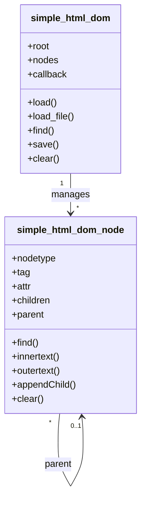

# 06 - Class Diagram

## Hasil Analisis Class pada Source Code

### Ringkasan

- Pada kode aplikasi domain (module admin/diagnosa/dll), **tidak ditemukan class PHP** untuk controller/model/entity.
- Class yang ditemukan berasal dari library parser HTML:
  1. `simple_html_dom_node`
  2. `simple_html_dom`

Class tersebut dipakai terutama oleh fitur `modul/harga.php` melalui fungsi `file_get_html(...)`.

## Daftar Class

| Class | Lokasi | Peran |
|---|---|---|
| `simple_html_dom_node` | `simple_html_dom.php` | Representasi node DOM HTML |
| `simple_html_dom` | `simple_html_dom.php` | Parser DOM HTML |

## Attribute Utama

### simple_html_dom_node
- `nodetype`
- `tag`
- `attr`
- `children`
- `nodes`
- `parent`
- `tag_start`

### simple_html_dom
- `root`
- `nodes`
- `callback`
- `lowercase`
- `size`
- `_charset`
- `_target_charset`
- `self_closing_tags`
- `block_tags`
- `optional_closing_tags`

## Method Utama

### simple_html_dom_node (contoh)
- `__construct()`
- `clear()`
- `find()`
- `innertext()`
- `outertext()`
- `text()`
- `children()`
- `parent()`
- `appendChild()`

### simple_html_dom (contoh)
- `__construct()`
- `load()`
- `load_file()`
- `find()`
- `save()`
- `clear()`
- `parse()`
- `parse_attr()`
- `remove_noise()`

## Relationship

- `simple_html_dom` membangun struktur DOM.
- `simple_html_dom_node` menyimpan node dan referensi parent/children.
- Relasi utama: `simple_html_dom` **mengelola banyak** `simple_html_dom_node`.

## Class Diagram (Mermaid)

## Catatan Ketersediaan Informasi

- Class diagram domain (Admin, Gejala, Gangguan, dll) **tidak tersedia sebagai class nyata pada source code**; implementasi domain masih procedural.

## Referensi Source Code

- `simple_html_dom.php`
- `modul/harga.php` (pemanggilan `file_get_html`)
