# 07 - Sequence Diagram

## 1) Beranda

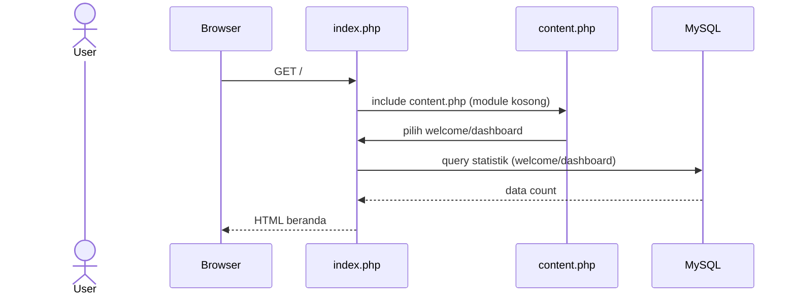

## 2) Diagnosis Gangguan

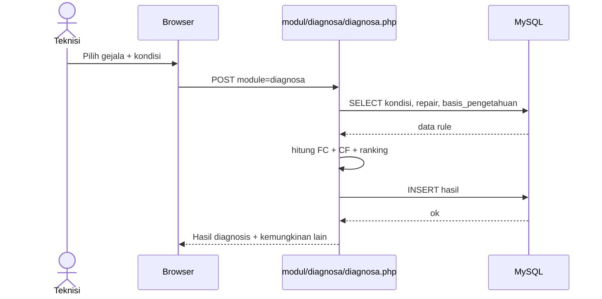

## 3) Kelola Artikel/Keterangan

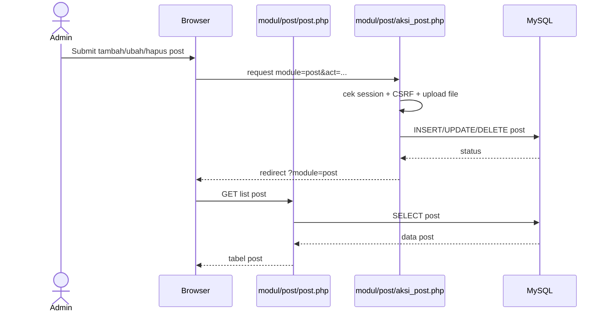

## 4) Tentang

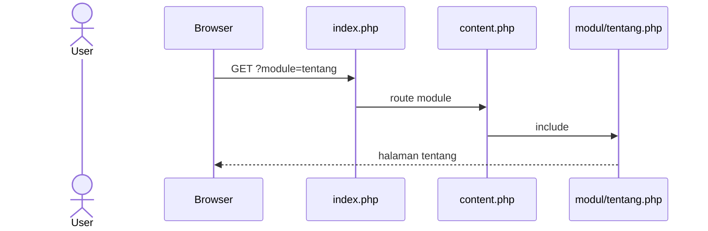

## 5) Login Admin

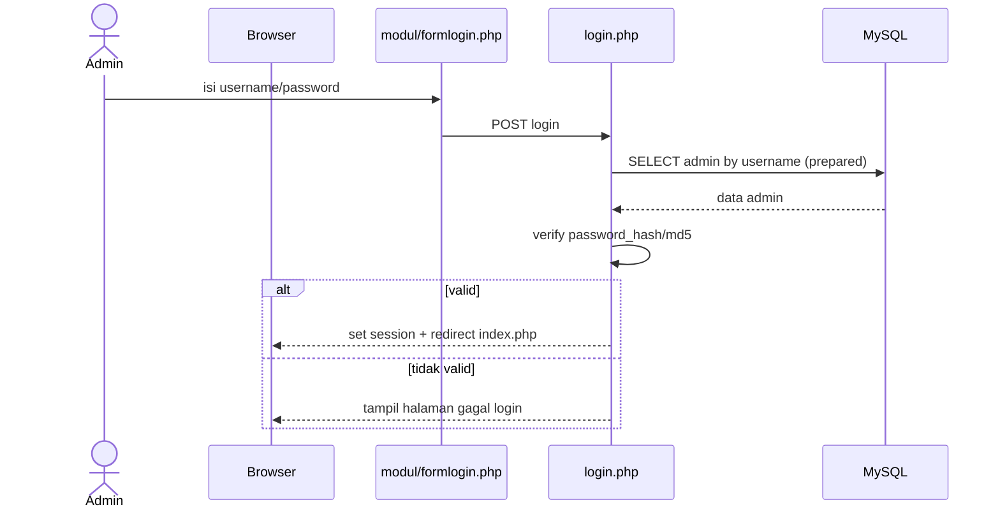

## 6) Kelola Data Admin

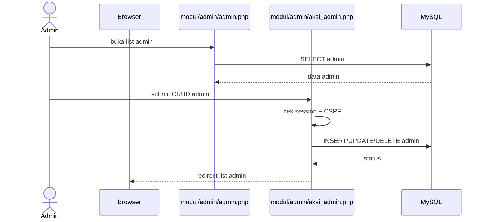

## 7) Kelola Data Gangguan

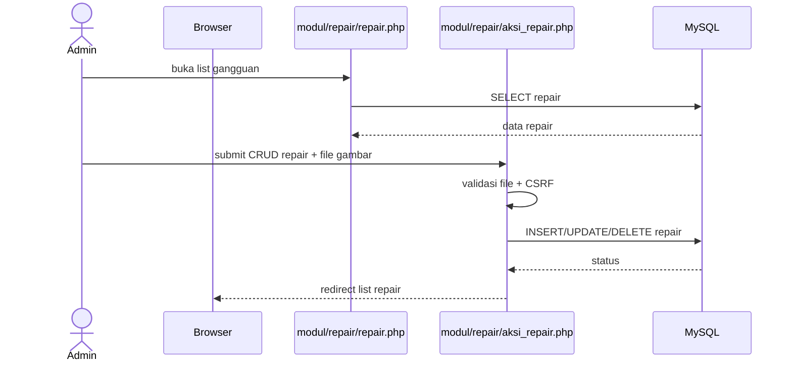

## 8) Kelola Data Gejala

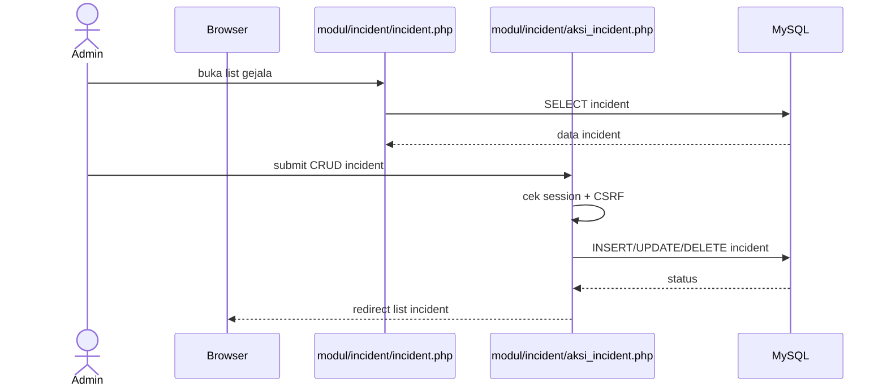

## 9) Kelola Basis Pengetahuan

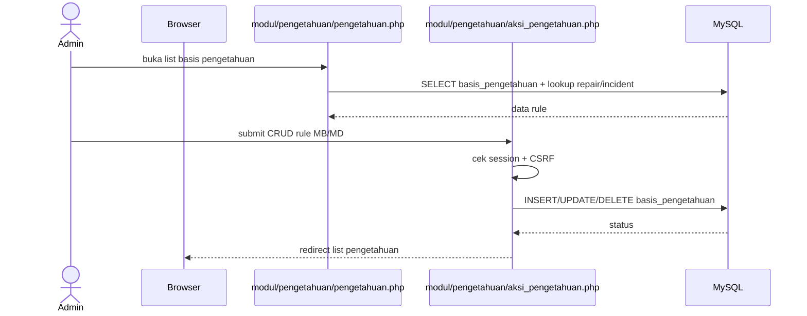

## 10) Ubah Password

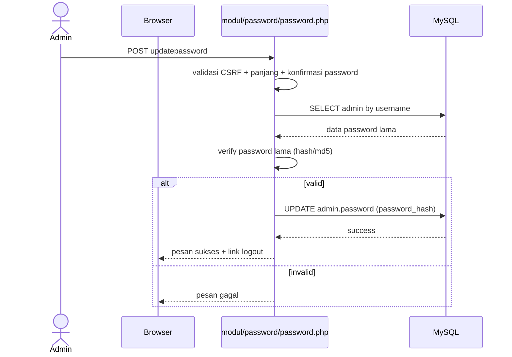

## 11) Logout

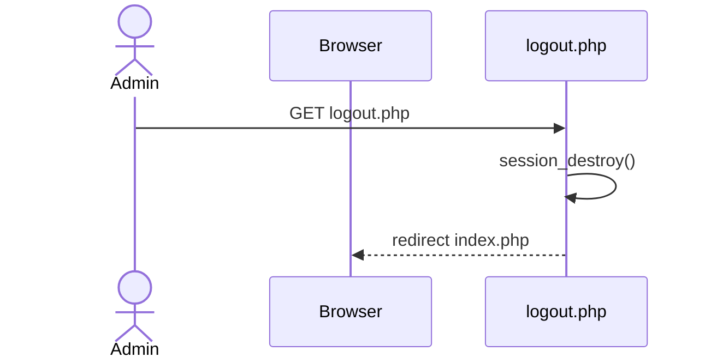

## Referensi Source Code

- `index.php`
- `content.php`
- `modul/welcome.php`
- `modul/dashboard.php`
- `modul/diagnosa/diagnosa.php`
- `modul/post/post.php`
- `modul/post/aksi_post.php`
- `modul/tentang.php`
- `modul/formlogin.php`
- `login.php`
- `modul/admin/admin.php`
- `modul/admin/aksi_admin.php`
- `modul/repair/repair.php`
- `modul/repair/aksi_repair.php`
- `modul/incident/incident.php`
- `modul/incident/aksi_incident.php`
- `modul/pengetahuan/pengetahuan.php`
- `modul/pengetahuan/aksi_pengetahuan.php`
- `modul/password/password.php`
- `logout.php`
