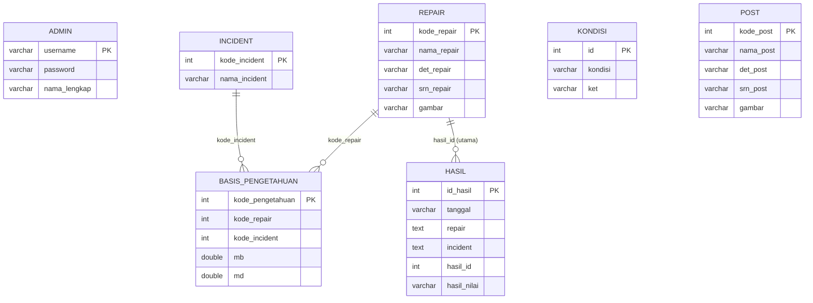

# 08 - Database

## Ringkasan

Database utama: `dignet` (lihat dump: `dignet_indihome.sql`).

Tabel utama:
- `admin`
- `repair`
- `incident`
- `basis_pengetahuan`
- `kondisi`
- `hasil`
- `post`

## Rancangan Relasi Antar Tabel (Logis)

1. `basis_pengetahuan.kode_repair` -> `repair.kode_repair`
2. `basis_pengetahuan.kode_incident` -> `incident.kode_incident`
3. `hasil.hasil_id` -> `repair.kode_repair` (diagnosis utama)
4. `hasil.repair` (serialized map) mereferensikan banyak `repair` secara logis
5. `hasil.incident` (serialized map) mereferensikan banyak `incident` secara logis

> Catatan: relasi di atas dipakai pada query aplikasi, namun dump SQL tidak menambahkan foreign key constraint eksplisit.

## Entity Relationship Diagram (Mermaid ER)

## Penjelasan Setiap Tabel

### 1) `admin`
- Menyimpan akun admin.
- PK: `username`.
- Dipakai oleh login dan manajemen admin/password.

### 2) `repair`
- Master data gangguan + detail + saran + gambar.
- PK: `kode_repair`.

### 3) `incident`
- Master data gejala.
- PK: `kode_incident`.

### 4) `basis_pengetahuan`
- Rule sistem pakar (gejala-gangguan + MB/MD).
- PK: `kode_pengetahuan`.
- FK logis: `kode_repair`, `kode_incident`.

### 5) `kondisi`
- Master skala keyakinan user.
- PK: `id`.
- Digunakan dalam form diagnosis.

### 6) `hasil`
- Menyimpan histori diagnosis.
- PK: `id_hasil`.
- `incident` dan `repair` disimpan sebagai string serialized PHP.
- `hasil_id` menyimpan ID gangguan utama.

### 7) `post`
- Konten artikel/keterangan gangguan.
- PK: `kode_post`.

## Primary Key

| Tabel | Primary Key |
|---|---|
| admin | username |
| repair | kode_repair |
| incident | kode_incident |
| basis_pengetahuan | kode_pengetahuan |
| kondisi | id |
| hasil | id_hasil |
| post | kode_post |

## Foreign Key

### Kondisi di Dump SQL
- Tidak ada deklarasi `FOREIGN KEY` eksplisit.

### Relasi Logis yang Dipakai Aplikasi
- `basis_pengetahuan.kode_repair` -> `repair.kode_repair`
- `basis_pengetahuan.kode_incident` -> `incident.kode_incident`
- `hasil.hasil_id` -> `repair.kode_repair`

## Kardinalitas

- `repair` 1 : N `basis_pengetahuan`
- `incident` 1 : N `basis_pengetahuan`
- `repair` 1 : N `hasil` (melalui `hasil_id`, diagnosis utama)

## Catatan Ketersediaan Informasi

- Karena kolom `hasil.repair` dan `hasil.incident` diserialisasi, relasi banyak-ke-banyak historis tidak dinormalisasi sebagai tabel junction.

## Referensi Source Code

- `dignet_indihome.sql`
- `modul/diagnosa/diagnosa.php`
- `modul/riwayat/riwayat.php`
- `modul/riwayat/detail.php`
- `modul/pengetahuan/pengetahuan.php`
- `modul/pengetahuan/aksi_pengetahuan.php`
